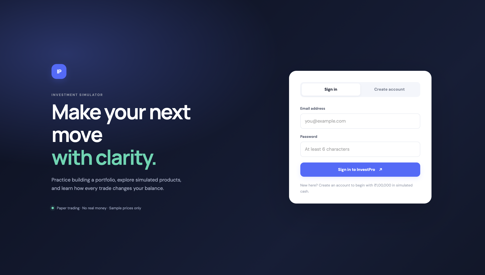
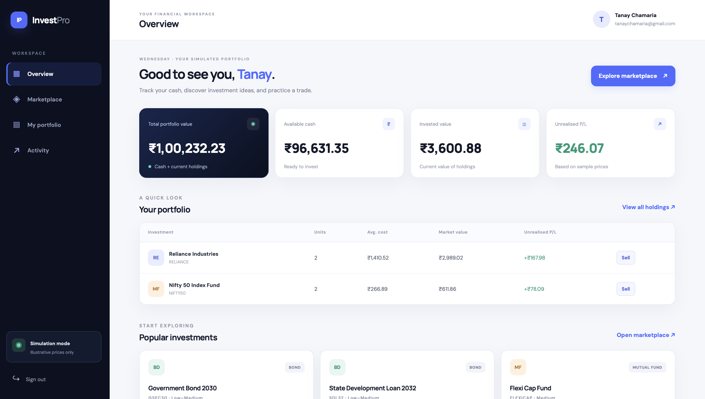

# InvestPro — Investment Portfolio & Trading Simulator

InvestPro is a web application developed for a Java OOP coursework project. Users can register and sign in, browse sample stocks, bonds and mutual funds, simulate buy and sell orders, monitor portfolio value and profit/loss, view transaction history, and export transaction history as CSV.

> **Important:** This is a coursework simulation. Investment prices are illustrative and are not live market prices. No real money or real trades are involved.

## Features

- User registration and login
- Investment portfolio management
- Stocks, bonds, and mutual funds
- Simulated buying and selling
- Simulated market price movements
- Portfolio valuation and profit/loss tracking
- Transaction history
- CSV export of transaction history
- Input validation and exception handling

## Tech Stack

- **Language:** Java
- **Backend:** Spring Boot
- **Database:** MySQL 8.4
- **Database Connectivity:** JDBC and JdbcTemplate
- **Frontend:** HTML, CSS, and JavaScript
- **Build Tool:** Maven

## Object-Oriented Programming Concepts

This project demonstrates the following Java OOP concepts:

- **Encapsulation:** Protecting object data using private fields and controlled access.
- **Inheritance:** Specialized investment classes extend a common investment class.
- **Abstraction:** A common abstract investment class defines shared behaviour.
- **Polymorphism:** Different investment types implement their own behaviour.
- **Interfaces:** The Tradable interface defines common trading operations.
- **Method Overloading:** Methods can use different parameter lists.
- **Method Overriding:** Subclasses provide their own implementations of inherited methods.
- **Exception Handling:** Custom exceptions handle errors such as insufficient funds and invalid quantities.

## Project Architecture

- **Models:** Represent users and investment instruments.
- **Controllers:** Handle incoming HTTP requests.
- **Services:** Implement authentication, trading, portfolio management, and market simulation.
- **Repositories:** Support database operations.
- **Frontend:** Provides the user interface using HTML, CSS, and JavaScript.
- **Database:** Stores user and investment-related information in MySQL.

## Requirements

- JDK 21 or newer
- Maven 3.9 or newer
- MySQL 8.4
- VS Code or another code editor
- A modern web browser

## Running the Project on macOS

The following instructions describe the local development setup. MySQL paths and ports may differ on other computers.

### 1. Start MySQL 8.4

The development machine uses the MySQL 8.4 data directory `/opt/homebrew/var/mysql84`, socket `/tmp/mysql84.sock`, and port `3307`.

If the existing MySQL server is stopped, open a separate Terminal window and run:

```bash
/opt/homebrew/opt/mysql@8.4/bin/mysqld_safe \
  --datadir=/opt/homebrew/var/mysql84 \
  --port=3307 \
  --socket=/tmp/mysql84.sock \
  --pid-file=/tmp/mysql84.pid \
  --log-error=/tmp/mysql84-recovery.err &
```

Check whether the server is running:

```bash
/opt/homebrew/opt/mysql@8.4/bin/mysqladmin --socket=/tmp/mysql84.sock ping
```

The expected response is:

```text
mysqld is alive
```

**Important:** Use the existing MySQL 8.4 data directory. Do not point this server at another MySQL installation's data directory or delete existing database files.

### 2. Set Up the Database

Open the InvestPro project folder in VS Code.

Select **Terminal → New Terminal** and make sure the terminal is in the directory containing `pom.xml` and the `database` folder.

Run:

```bash
/opt/homebrew/opt/mysql@8.4/bin/mysql --socket=/tmp/mysql84.sock -u root -p < database/setup.sql
```

Enter your existing MySQL root password when prompted.

Review `database/setup.sql` before running it to understand the operations it performs.

The application uses `schema.sql` and `data.sql` to initialize its tables and sample investment data when configured to do so by Spring Boot.

### 3. Configure the Database Password

Open `src/main/resources/application.properties` and verify that the password is read from an environment variable:

```properties
spring.datasource.password=${DB_PASSWORD}
```

In the same Terminal session, set the environment variable:

```bash
export DB_PASSWORD='your_local_database_password'
```

Replace the example value with your actual local database password. Never commit real passwords to GitHub.

### 4. Start the Application

From the project directory, run:

```bash
mvn spring-boot:run
```

Maven may need an internet connection to download dependencies on the first run.

When Spring Boot starts successfully, open the following address in your browser:

**http://localhost:8080**

Register an account using your name, email, and a password of at least six characters.

New accounts start with ₹1,00,000 in simulated cash.

### 5. Stop the Application

Return to the Terminal running Spring Boot and press **Control + C**.

This stops the web application but does not delete the database.

## Troubleshooting

### Maven Command Not Found

Check whether Maven is installed:

```bash
mvn -v
```

If Maven is installed but unavailable in VS Code, restart VS Code and open a new terminal.

### MySQL Connection Refused

Confirm that MySQL 8.4 is running and that the configured host and port match your application settings.

### Access Denied for the Application User

Verify the database username and password in `database/setup.sql` and `application.properties`. Review the database user's permissions if necessary.

### Port 8080 Is Already in Use

Stop the other application using port 8080 or change the Spring Boot server port in `application.properties`.

### Database Errors

Review the Spring Boot terminal output and verify the database connection settings. Do not delete or reinitialize existing MySQL data directories as a troubleshooting shortcut.

## Application Screenshots

Add screenshots of your actual application to the `screenshots` folder in the project directory.

Replace the example filenames below with the exact names of your screenshot files.

### Login Page



### Portfolio Dashboard



### Investment Listings


## Security Note

This project is intended for local coursework and demonstration purposes. Never publish real passwords, database credentials, or private information. Before deploying publicly, implement appropriate production-grade authentication, authorization, input validation, and security controls.

## Disclaimer

InvestPro is an educational simulation. It does not provide real-time market data, execute actual trades, or offer financial advice.